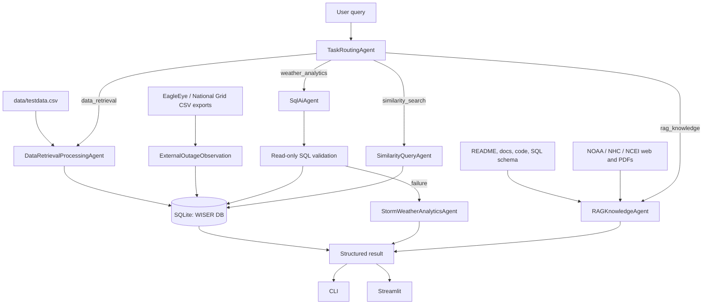

# WISER Documentation

WISER, Weather Integrated Storm Event Response, is a Connecticut storm outage analytics system built around a small multi-agent architecture. It ingests raw storm CSV data, normalizes it into SQLite, answers natural-language analytics questions, finds historically similar storms, retrieves grounded project/external context, and can stage EagleEye/National Grid-style outage CSV exports with source provenance.

## System Overview



The CLI and Streamlit app are renderers over the same handler layer: `src/wiser/handlers.py`. Routing, dispatch, SQL generation, similarity search, RAG, and fallback behavior should remain in shared code rather than being duplicated in interfaces.

## Database Schema

The schema source of truth is `sql/schema.sql`.

Core normalized tables:

| Table | Primary Key | Purpose |
|---|---|---|
| `Storm` | `stormCode` | One row per storm event, with event timestamp and duration. |
| `County` | `county` | County metadata, including `state` and `ohLine`. |
| `WeatherData` | `(stormCode, county)` | One weather/outage observation per storm-county pair. |

External staging table:

| Table | Primary Key / Unique Key | Purpose |
|---|---|---|
| `ExternalOutageObservation` | `id`, unique `(sourceSystem, sourceRecordId, observedAt)` | Stages EagleEye/National Grid-style outage exports without forcing them into the historical `(stormCode, county)` grain. |

Important indexes:

- `idx_weatherdata_outage`
- `idx_weatherdata_county`
- `idx_storm_datetime`
- `idx_external_outage_source_time`
- `idx_external_outage_county`

`ExternalOutageObservation` fields:

- `sourceSystem`
- `sourceRecordId`
- `observedAt`
- `county`
- `serviceTerritory`
- `outageCount`
- `customerCount`
- `restorationStatus`
- `rawPayload`

The raw payload is preserved for provenance and debugging.

## Data Pipeline

The raw dataset is `data/testdata.csv`, with 2,352 storm-county rows.

Pipeline flow:

1. `src/wiser/data_pipeline.py::load_raw_csv()` reads the source CSV.
2. `normalize_rows()` extracts:
   - unique storm records
   - unique county records
   - weather observations
3. `write_normalized_csvs()` writes normalized CSV artifacts.
4. `src/wiser/database.py::initialize_schema()` loads `sql/schema.sql`.
5. `load_normalized_rows()` populates SQLite.

Bootstrap command:

```bash
python3 scripts/bootstrap_wiser.py
```

## Agent Framework

| Agent | Responsibility | Guardrail |
|---|---|---|
| `TaskRoutingAgent` | Classifies user intent into route enums. | Ground-truth fixture with 43 route cases. |
| `DataRetrievalProcessingAgent` | Builds/refreshes normalized CSVs and SQLite DB. | Schema and table-count tests. |
| `SqlAiAgent` | Converts natural language analytics questions into SQLite `SELECT` queries. | Read-only validation and semantic SQL tests. |
| `StormWeatherAnalyticsAgent` | Deterministic analytics fallback. | Fixed query wrappers. |
| `SimilarityQueryAgent` | Finds similar historical storms for a county. | Feature parsing and math tests. |
| `RAGKnowledgeAgent` | Answers grounded documentation/context questions. | Citations and context tests. |

Route priority:

1. RAG explanation/documentation queries, unless numeric similarity parameters are present.
2. Similarity search when query uses similarity wording or known feature aliases.
3. Explicit data-management commands such as build, load, normalize, ingest, refresh, raw, or CSV.
4. Weather analytics.
5. Data/database metadata fallback.
6. Unknown route with examples.

Evaluate routing:

```bash
python3 scripts/wiser_cli.py --evaluate-routing
```

## SQL AI Agent

The SQL AI Agent asks an LLM to generate SQLite `SELECT` statements, validates the generated SQL, then executes it through a read-only database connection.

Rules enforced by code/tests:

- Only single `SELECT` or read-only CTE-style statements are allowed.
- Write statements such as `INSERT`, `UPDATE`, `DELETE`, `DROP`, `ALTER`, `CREATE`, `REPLACE`, `TRUNCATE`, and unsafe `PRAGMA` use are rejected.
- SQL is cleaned of Markdown fences before validation.
- If SQL AI fails, weather analytics falls back to deterministic query wrappers.

Ground-truth SQL evaluation:

```bash
python3 scripts/wiser_cli.py --evaluate-sql
```

The SQL ground-truth fixture has 27 semantic cases. Tests compare result rows, not just SQL strings.

Example:

```bash
python3 scripts/wiser_cli.py "What is the total outage count for Fairfield county?" --show-sql
```

OpenAI configuration is read from the repo-root `.env` or environment:

```dotenv
OPENAI_API_KEY=...
WISER_OPENAI_MODEL=gpt-5.5
```

Never commit API keys.

## Storm Similarity

The storm similarity engine ranks historical storms in a county against current conditions using multi-dimensional Z-score distance.

Supported weather features:

- `peakWSPD10`
- `sumAFWA_TOTPRECIP`
- `wgt5`
- `wgt9`
- `wgt13`
- `wgt18`

Process:

1. Fetch historical rows for a county.
2. Compute mean and sample standard deviation for selected features.
3. Convert historical and query values into Z-scores.
4. Compute weighted Euclidean distance in Z-score space.
5. Convert distance to similarity:

```text
similarity = 1 / (1 + distance)
```

Interpretation:

- `1.0` means exact match on active features.
- `0.5` means cumulative Z-score distance of `1.0`.
- Near `0.0` means very dissimilar.

Direct CLI:

```bash
python3 scripts/find_similar_storms.py --county Fairfield --wind-speed 9.2 --precip 45.0 --limit 5
```

Natural-language CLI:

```bash
python3 scripts/wiser_cli.py "find storms similar to wind=9.2 precip=45 in Fairfield" --limit 5
```

Implementation files:

- `src/wiser/similarity_engine.py`
- `src/wiser/agents/similarity_query_agent.py`
- `scripts/find_similar_storms.py`

## RAG And External Storm Context

RAG answers documentation and storm-impact questions with retrieved context and citations.

Default external sources:

- National Hurricane Center 2020 Atlantic Tropical Cyclone Reports
- National Hurricane Center 2020 Eastern Pacific Tropical Cyclone Reports
- NCEI Connecticut Billion-Dollar Weather and Climate Disasters summary

Impact-style query:

```bash
python3 scripts/wiser_cli.py "impact of the new storm in Connecticut" --limit 5
```

Useful flags:

```bash
python3 scripts/wiser_cli.py "impact of the new storm" --crawl-web-sources
python3 scripts/wiser_cli.py "impact of the new storm" --max-linked-pdfs 10
python3 scripts/wiser_cli.py "impact of the new storm" --similarity-backend exact
python3 scripts/wiser_cli.py "impact of the new storm" --no-openai-summary
```

Optional dependencies:

```bash
pip install faiss-cpu numpy pypdf
```

Without FAISS, WISER uses a dependency-free exact text-vector fallback. Without `pypdf`, it tries `pdftotext` and then a lightweight PDF text fallback.

## EagleEye And National Grid CSV Loading

WISER now supports fixture-backed CSV/file loading for EagleEye and National Grid-style outage data. This does not require OpenAI and does not make live API calls.

Load EagleEye-style CSV:

```bash
python3 scripts/wiser_cli.py \
  --load-external \
  --external-source eagleeye \
  --external-file tests/fixtures/eagleeye_sample.csv \
  --db data/wiser.db
```

Load National Grid-style CSV:

```bash
python3 scripts/wiser_cli.py \
  --load-external \
  --external-source national-grid \
  --external-file tests/fixtures/national_grid_sample.csv \
  --db data/wiser.db
```

Parser files:

- `src/wiser/integrations/external_outage.py`
- `src/wiser/integrations/eagleeye.py`
- `src/wiser/integrations/national_grid.py`

Fixture files:

- `tests/fixtures/eagleeye_sample.csv`
- `tests/fixtures/national_grid_sample.csv`

Live EagleEye/National Grid API fetching is intentionally not included yet. It requires each source system's endpoint, auth details, field dictionary, timezone semantics, and access permissions.

## CLI Quick Reference

Build database:

```bash
python3 scripts/bootstrap_wiser.py
```

Run analytics:

```bash
python3 scripts/wiser_cli.py "top counties by outage" --limit 5
python3 scripts/wiser_cli.py "top storms by outage" --limit 5
python3 scripts/wiser_cli.py "history for county Hartford" --limit 10
```

Run SQL AI dry-run:

```bash
python3 scripts/wiser_cli.py "top storms by outage" --dry-run-sql
```

Run full ground-truth evaluation:

```bash
python3 scripts/wiser_cli.py --evaluate-routing --evaluate-sql
```

Run Streamlit:

```bash
streamlit run streamlit_app.py
```

The Streamlit interface includes presentation-ready tabs:

- `Demo status`: routing and SQL ground-truth pass metrics, external feed readiness, and documentation location.
- `External outage staging`: one-click loading for the EagleEye and National Grid sample CSVs plus a preview of staged rows.

For a no-install professor walkthrough, open `mock_interface/index.html`. It
mirrors the implementation status, external feed staging preview, agent demo
queries, and architecture diagram without requiring Streamlit.

## Testing

Run the full suite:

```bash
python3 -m unittest discover -s tests -v
```

Current expected status:

```text
OK
```

Some Streamlit tests are skipped when optional `streamlit` is not installed.

Important test areas:

- schema constraints and indexes
- data pipeline normalization
- task routing ground truth
- SQL AI validation and semantic ground truth
- handler dispatch and fallback behavior
- storm similarity math
- RAG retrieval and citations
- external web/PDF parsing
- EagleEye/National Grid CSV parser and staging-table loading

## Source Map

Core code:

- `src/wiser/handlers.py`
- `src/wiser/database.py`
- `src/wiser/data_pipeline.py`
- `src/wiser/query_engine.py`
- `src/wiser/rag.py`
- `src/wiser/external_sources.py`
- `src/wiser/similarity_engine.py`
- `src/wiser/integrations/`
- `src/wiser/agents/`

Interfaces:

- `scripts/wiser_cli.py`
- `scripts/bootstrap_wiser.py`
- `scripts/find_similar_storms.py`
- `streamlit_app.py`

Data/schema:

- `data/testdata.csv`
- `sql/schema.sql`
- `tests/fixtures/`
