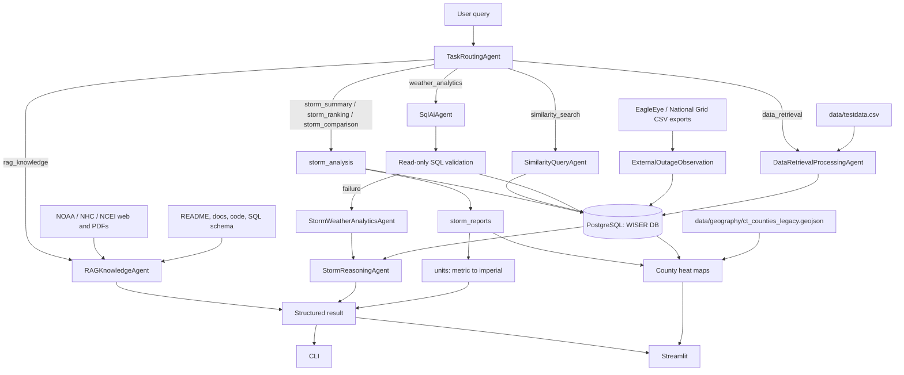

# WISER Documentation

WISER, Weather Integrated Storm Event Response, is a Connecticut storm outage analytics system built around a small multi-agent architecture. It ingests raw storm CSV data, normalizes it into PostgreSQL, answers natural-language analytics questions, writes storm-scoped reports for a single storm or a pair, finds historically similar storms, retrieves grounded project/external context, and can stage EagleEye/National Grid-style outage CSV exports with source provenance.

## System Overview



The CLI and Streamlit app are renderers over the same handler layer: `src/wiser/handlers.py`. Routing, dispatch, SQL generation, similarity search, RAG, and fallback behavior should remain in shared code rather than being duplicated in interfaces.

## Database Schema

The schema source of truth is `sql/schema.sql`.

Core normalized tables:

| Table | Primary Key | Purpose |
|---|---|---|
| `Storm` | `stormCode` | One row per storm event, with event timestamp and duration. |
| `County` | `county` | County metadata, including `state` and `ohLine`. |
| `WeatherData` | `(stormCode, county)` | One weather/outage observation per storm-county pair. |

External staging table:

| Table | Primary Key / Unique Key | Purpose |
|---|---|---|
| `ExternalOutageObservation` | `id`, unique `(sourceSystem, sourceRecordId, observedAt)` | Stages EagleEye/National Grid-style outage exports without forcing them into the historical `(stormCode, county)` grain. |

Important indexes:

- `idx_weatherdata_lower_county`
- `idx_county_lower_county`
- `idx_county_lower_state`
- `idx_region_lower_state_region`
- `idx_external_outage_source_time`
- `idx_external_outage_county`

The county/state indexes are on `LOWER(...)` rather than the raw column.
Every county join and state filter in the codebase compares case-insensitively
(`JOIN County c ON LOWER(c.county) = LOWER(w.county)`), and PostgreSQL cannot
use a plain b-tree for a function-wrapped predicate — so a raw-column index on
these would never be chosen by the planner. Indexes that merely duplicate a
primary key or `UNIQUE` constraint (`Storm(eventDateTime)`, the
`HourlyWeatherObservation` PK prefix) are deliberately absent: they cost writes
and serve no read.

`ExternalOutageObservation` fields:

- `sourceSystem`
- `sourceRecordId`
- `observedAt`
- `county`
- `serviceTerritory`
- `outageCount`
- `customerCount`
- `restorationStatus`
- `rawPayload`

The raw payload is preserved for provenance and debugging.

## Data Pipeline

The raw dataset is `data/testdata.csv`, with 2,352 storm-county rows.

Pipeline flow:

1. `src/wiser/data_pipeline.py::load_raw_csv()` reads the source CSV.
2. `normalize_rows()` extracts:
   - unique storm records
   - unique county records
   - weather observations
3. `write_normalized_csvs()` writes normalized CSV artifacts.
4. `src/wiser/database.py::initialize_schema()` loads `sql/schema.sql`.
5. `load_normalized_rows()` populates PostgreSQL.

Bootstrap command:

```bash
python3 scripts/bootstrap_wiser.py
```

## Agent Framework

| Agent | Responsibility | Guardrail |
|---|---|---|
| `TaskRoutingAgent` | Classifies user intent into route enums. | Ground-truth fixture with 68 route cases. |
| `DataRetrievalProcessingAgent` | Builds/refreshes normalized CSVs and the PostgreSQL database. | Schema and table-count tests. |
| `SqlAiAgent` | Converts natural language analytics questions into PostgreSQL `SELECT` queries. | Read-only validation and semantic SQL tests. |
| `StormReasoningAgent` | Explains validated SQL/fallback rows with row-grounded reasoning and caveats. | Prompt/fallback tests. |
| `StormWeatherAnalyticsAgent` | Deterministic analytics fallback. | Fixed query wrappers. |
| `SimilarityQueryAgent` | Finds similar historical storms for a county. | Feature parsing and math tests. |
| `RAGKnowledgeAgent` | Answers grounded documentation/context questions. | Citations and context tests. |

Route priority, as implemented in `TaskRoutingAgent.route`:

1. Storm-scoped intents (summary, ranking, comparison). These run first because their verbs — "summarize", "compare", "rank" — are already owned by the RAG and similarity routes. An identifier gate inside keeps them from firing on anything that does not name a storm, and the gate yields to explicit data-management phrasing so `"load the raw storm csv 2020080406"` stays a data command.
2. RAG explanation/documentation queries, unless numeric similarity parameters are present.
3. Similarity search when query uses similarity wording or known feature aliases.
4. Explicit data-management commands such as build, load, file/database normalize, ingest, refresh, raw, or CSV.
5. Weather analytics.
6. Data/database metadata fallback.
7. Unknown route with examples.

Documentation verbs deliberately do *not* block a storm intent — that behaviour is pinned by fixture `routing_guard_002`.

Evaluate routing:

```bash
python3 scripts/wiser_cli.py --evaluate-routing
```

## SQL AI Agent

The SQL AI Agent asks an LLM to generate PostgreSQL `SELECT` statements, validates the generated SQL, then executes it inside a server-enforced read-only transaction.

Rules enforced by code/tests:

- Only single `SELECT` or read-only CTE-style statements are allowed.
- Write statements such as `INSERT`, `UPDATE`, `DELETE`, `DROP`, `ALTER`, `CREATE`, `REPLACE`, `TRUNCATE`, and unsafe `PRAGMA` use are rejected.
- SQL is cleaned of Markdown fences before validation.
- If SQL AI fails, weather analytics falls back to deterministic query wrappers.

Ground-truth SQL evaluation:

```bash
python3 scripts/wiser_cli.py --evaluate-sql
```

The SQL ground-truth fixture has 27 semantic cases. Tests compare result rows, not just SQL strings.

After rows are returned, `StormReasoningAgent` builds a second prompt from only
the user question, validated SQL, and returned rows. It is tuned to answer
analytical questions such as:

- which county was affected most
- why one county had higher outage despite lower wind
- whether wind severity and outage severity rank the same
- how results change under available normalization

Population is not currently in the WISER schema. If a question asks for
population-normalized results, WISER says that directly and uses the available
`County.ohLine` exposure normalization only as an infrastructure proxy.

Example:

```bash
python3 scripts/wiser_cli.py "What is the total outage count for Fairfield county?" --show-sql
```

OpenAI configuration is read from the repo-root `.env` or environment:

```dotenv
OPENAI_API_KEY=...
WISER_OPENAI_MODEL=gpt-4o-mini
```

`WISER_OPENAI_MODEL` overrides the model for every component that calls OpenAI.
Left unset, the built-in defaults differ by component: `gpt-4o-mini` for SQL
generation (`DEFAULT_SQL_MODEL`) and analytical reasoning
(`DEFAULT_REASONING_MODEL`), `gpt-5.5` for impact summarization
(`DEFAULT_OPENAI_MODEL` in `openai_summarizer.py`). `--sql-model` and
`--openai-model` override the SQL and summarizer models for a single run.

Never commit API keys.

## Storm-Scoped Reports

A query that names a specific storm routes away from ad-hoc SQL and into two
modules: `src/wiser/storm_analysis.py` computes, `src/wiser/storm_reports.py`
renders. A storm is named by 10-digit code (`2020080406`) or by date
(`2020-08-04`); when a date resolves to more than one storm, the reports say so
rather than silently picking one.

| Capability | Route | What the report contains |
|---|---|---|
| 1 — Storm Summary | `storm_summary` | Statewide and per-county impact for one storm, its analysis window, and a relative-impact sentence. |
| 2 — Storm Ranking | `storm_ranking` | Where the storm sits in the historical record, by percentile, per metric. |
| 3 — Storm Comparison | `storm_comparison` | *Mode A*: two stored storms, metric by metric. *Mode B*: an inbound forecast against its closest historical analogues. |

Rules the reports hold to:

- **Units convert only at the boundary.** The database stores metric
  (`m/s`, `mm`); reports render imperial (`mph`, `inches`) through
  `src/wiser/units.py`. Nothing upstream of rendering sees imperial values.
- **Forecast unit suffixes must touch the number.** `wind=12ms` and
  `precip=1.2in` parse; a detached suffix does not, because
  `"precip=1.2 in Fairfield"` would otherwise read the preposition as inches.
- **An analogue's outage is history, never a forecast.** Mode B reports label
  analogue outcomes as recorded history. A named reference storm in Mode B
  renders as "Named reference storm (actual)" beside the analogues.
- **Modeled values are labelled as modeled.** `peakWSPD10` and
  `sumAFWA_TOTPRECIP` are AFWA model output, not station observations, and
  carry `[modeled, …]` labels.
- **Absent metadata is stated, not inferred.** Storm type, peak snowfall, and
  wind gusts need the Phase 2 metadata table that has not been built, so
  Capability 1 renders them as explicitly unavailable.
- **Differences below display resolution say so.** Two values that render
  identically report `<0.1 mph` rather than a spurious difference.

Reasoning is attached to the summary only: its rows are county-shaped, which is
what the reasoning layer reads. Ranking and comparison rows are metric-shaped
and already carry their interpretation, computed deterministically.

Design record and as-built notes: [STORM_SCOPED_ANALYSIS_PLAN.md](STORM_SCOPED_ANALYSIS_PLAN.md).

## County Heat Maps

The Streamlit app includes a `County heat maps` tab. It loads
`data/geography/ct_counties_legacy.geojson`, the State of Connecticut legacy
8-county boundary layer, so the map matches the dataset county names:

`Fairfield`, `Hartford`, `Litchfield`, `Middlesex`, `New Haven`, `New London`,
`Tolland`, `Windham`

Supported heat-map metrics, registered in `COUNTY_HEATMAP_METRICS`:

| Key | Metric | Zero-anchored |
|---|---|---|
| `outage` | outage trouble spots for a single storm | yes |
| `total_outage` | total outage trouble spots | yes |
| `avg_outage` | average outage trouble spots | yes |
| `peak_outage` | peak outage trouble spots | yes |
| `avg_peak_wind` | average peak wind speed | no |
| `max_peak_wind` | maximum peak wind speed | no |
| `outage_per_million_ohline` | outage trouble spots per 1,000,000 `ohLine` | yes |

The renderer is dependency-free: `src/wiser/visualization.py` loads GeoJSON,
aggregates county metrics from PostgreSQL, projects lon/lat coordinates into an
inline SVG, and includes a legend plus county tooltips.

Colour scale:

- **One hue, light to dark.** The quantity is a magnitude, so the colour has to
  order itself the way the numbers do. An earlier blue→orange→red ramp read as
  three categories rather than one scale.
- **Two maps shown together share one range.** Scaled to themselves, a storm
  with 975 outages paints as dark as one with 21,557 and inverts the comparison
  the reader is making. `render_county_heatmap_svg(..., value_range=...)` pins
  the scale; `comparison_map_panels` computes the range across both panels.
- **Magnitude metrics are compressed, and which ones is declared, not guessed.**
  Outage counts are heavily skewed, so a zero-anchored linear scale spends the
  whole ramp on the top storm. Zero-anchored metrics position values by
  `value ** 0.4`, which preserves ordering while giving the low end more of the
  ramp. The `zero_anchored` flag on `CountyHeatmapMetric` decides this, so it
  is a property of the quantity — wind speed has no meaningful zero and stays
  linear — rather than of whether a particular slice happened to contain a zero.
- **Compression has a limit, and it is not a defect.** It buys back contrast at
  moderate ratios; it cannot at extreme ones. Storm `2020080406` (peak county
  5,935) against `2017031606` (peak county 8) is 742:1, and every county of the
  smaller storm lands in band 0 — positions 0.031 to 0.071, all inside the
  first band's width. Rendering that storm with visible internal contrast would
  assert a variation that is not there at the scale being compared on. The map
  reads uniformly pale and the panel caption names the storm's own peak county
  and value, which is where the detail belongs.
- **The legend labels alternate band boundaries**, since unequal band widths
  cannot be read off the colours. Labelling all eight collided at panel width;
  both ends are always labelled, because a scale whose top is unstated cannot
  be read. A map with no spread in it collapses to a single swatch naming the
  value instead of repeating one range across seven bands.
- **No data is a texture, not a shade.** A hatch over an opaque warm base,
  against a cool ramp. Any single grey can collide with some step of a
  seven-step ramp — the previous one sat at 1.04:1 against the ramp's lightest
  colour — so the distinction is carried by texture and survives greyscale.
- **Comparison panels render at their own size.** Type in an SVG is sized in
  viewBox units, so it only arrives at its declared size when the viewBox
  matches the frame. `PANEL_MAP_WIDTH`/`PANEL_MAP_HEIGHT` and a frame of equal
  height keep the browser's scale at 1; squeezing the full-width map into a
  column scaled the labels to roughly half, and no font size can compensate
  for a transform applied after it.
- **Label ink flips on dark fills**, so the heaviest counties do not carry
  near-black text on a near-black fill.

## Storm Similarity

The storm similarity engine ranks historical storms in a county against current conditions using multi-dimensional Z-score distance.

Supported weather features:

- `peakWSPD10`
- `sumAFWA_TOTPRECIP`
- `wgt5`
- `wgt9`
- `wgt13`
- `wgt18`

Process:

1. Fetch historical rows for a county.
2. Compute mean and sample standard deviation for selected features.
3. Convert historical and query values into Z-scores.
4. Compute weighted Euclidean distance in Z-score space.
5. Convert distance to similarity:

```text
similarity = 1 / (1 + distance)
```

Interpretation:

- `1.0` means exact match on active features.
- `0.5` means cumulative Z-score distance of `1.0`.
- Near `0.0` means very dissimilar.

Direct CLI:

```bash
python3 scripts/find_similar_storms.py --county Fairfield --wind-speed 9.2 --precip 45.0 --limit 5
```

Natural-language CLI:

```bash
python3 scripts/wiser_cli.py "find storms similar to wind=9.2 precip=45 in Fairfield" --limit 5
```

Implementation files:

- `src/wiser/similarity_engine.py`
- `src/wiser/agents/similarity_query_agent.py`
- `scripts/find_similar_storms.py`

## RAG And External Storm Context

RAG answers documentation and storm-impact questions with retrieved context and citations.

Default external sources:

- National Hurricane Center 2020 Atlantic Tropical Cyclone Reports
- National Hurricane Center 2020 Eastern Pacific Tropical Cyclone Reports
- NCEI Connecticut Billion-Dollar Weather and Climate Disasters summary

Impact-style query:

```bash
python3 scripts/wiser_cli.py "impact of the new storm in Connecticut" --limit 5
```

Useful flags:

```bash
python3 scripts/wiser_cli.py "impact of the new storm" --crawl-web-sources
python3 scripts/wiser_cli.py "impact of the new storm" --max-linked-pdfs 10
python3 scripts/wiser_cli.py "impact of the new storm" --similarity-backend exact
python3 scripts/wiser_cli.py "impact of the new storm" --no-openai-summary
```

Optional dependencies:

```bash
pip install faiss-cpu numpy pypdf
```

Without FAISS, WISER uses a dependency-free exact text-vector fallback. Without `pypdf`, it tries `pdftotext` and then a lightweight PDF text fallback.

## EagleEye And National Grid CSV Loading

WISER now supports fixture-backed CSV/file loading for EagleEye and National Grid-style outage data. This does not require OpenAI and does not make live API calls.

Load EagleEye-style CSV:

```bash
python3 scripts/wiser_cli.py \
  --load-external \
  --external-source eagleeye \
  --external-file tests/fixtures/eagleeye_sample.csv
```

Load National Grid-style CSV:

```bash
python3 scripts/wiser_cli.py \
  --load-external \
  --external-source national-grid \
  --external-file tests/fixtures/national_grid_sample.csv
```

Parser files:

- `src/wiser/integrations/external_outage.py`
- `src/wiser/integrations/eagleeye.py`
- `src/wiser/integrations/national_grid.py`

Fixture files:

- `tests/fixtures/eagleeye_sample.csv`
- `tests/fixtures/national_grid_sample.csv`

Live EagleEye/National Grid API fetching is intentionally not included yet. It requires each source system's endpoint, auth details, field dictionary, timezone semantics, and access permissions.

## CLI Quick Reference

Build database:

```bash
python3 scripts/bootstrap_wiser.py
```

Run analytics:

```bash
python3 scripts/wiser_cli.py "top counties by outage" --limit 5
python3 scripts/wiser_cli.py "top storms by outage" --limit 5
python3 scripts/wiser_cli.py "history for county Hartford" --limit 10
python3 scripts/wiser_cli.py "which county was affected the most overall?" --limit 8
python3 scripts/wiser_cli.py "normalize outages by population" --limit 8
```

Run storm-scoped reports:

```bash
python3 scripts/wiser_cli.py "storm summary for 2020080406"
python3 scripts/wiser_cli.py "where does storm 2020080406 rank out of all storms"
python3 scripts/wiser_cli.py "compare storm 2020080406 and 2011082800"
python3 scripts/wiser_cli.py "compare an upcoming storm with wind=12ms to storm 2020080406"
```

Run SQL AI dry-run:

```bash
python3 scripts/wiser_cli.py "top storms by outage" --dry-run-sql
```

Run full ground-truth evaluation:

```bash
python3 scripts/wiser_cli.py --evaluate-routing --evaluate-sql
```

Run Streamlit:

```bash
streamlit run streamlit_app.py
```

The Streamlit interface includes presentation-ready tabs:

- `Demo status`: routing and SQL ground-truth pass metrics, external feed readiness, and documentation location.
- `County heat maps`: legacy CT county choropleths for single-storm outage, outage totals/averages/peaks, wind, and exposure-normalized metrics. A storm comparison draws both panels side by side on one shared colour scale.
- `External outage staging`: one-click loading for the EagleEye and National Grid sample CSVs plus a preview of staged rows.

For a no-install professor walkthrough, open `mock_interface/index.html`. It
mirrors the implementation status, external feed staging preview, agent demo
queries, and architecture diagram without requiring Streamlit.

## Performance And Caching

Optimization work is concentrated in a few deliberate places; everything
below degrades gracefully and none of it changes an answer.

**Connections.** `database.connect()` folds `lock_timeout` into the libpq
startup options, so a connection is ready in one round trip instead of three
and no longer sits idle-in-transaction. `database.connect_pooled()` checks a
connection out of a process-wide pool when `psycopg_pool` is installed (it is,
via the `pool` extra in `requirements.txt`) and falls back to a plain connect
when it is not; `close()` returns it to the pool, so the calling convention is
identical either way. The long-lived surfaces (Streamlit, the CLI REPL) use
it; one-shot CLI commands do not, because a pool that outlives a single query
buys nothing. The pool verifies each connection on checkout, which is what
lets it replace one that Neon's autosuspend dropped rather than failing the
first query after an idle spell.

Three things about `PooledConnection` are easy to get wrong:

* `__enter__`/`__exit__` are defined explicitly. Python resolves special
  methods on the type, so the forwarding `__getattr__` alone would leave
  `with conn:` — the idiomatic psycopg 3 transaction block — raising
  TypeError, and only on the pooled path, i.e. only in production.
* Pools own background worker threads, and `close_pools()` is registered
  with `atexit` the first time a pool is created. The threads are daemons, so
  interpreter shutdown does not wait on them; the stall comes from an
  unclosed pool being finalized by its own `__del__`, which runs the same
  5-second `gather()` that `close()` does and prints
  `couldn't stop thread 'pool-N-worker-M'` per worker. Closing at exit keeps
  that out of finalization.
* `tests/pg_harness.reset_schema()` closes pools **before** dropping the
  schema. `psycopg_pool.close()` does not close connections that are
  currently checked out, so a live pooled connection racing the rebuild
  surfaces as a `UniqueViolation` on `pg_type_typname_nsp_index`. Any new
  pooled code path in a test must return its connection.

**Bulk loading.** `database.copy_rows()` uses `COPY` for the plain inserts of
a database build. `database.executemany()` routes batches under
`EXECUTEMANY_PIPELINE_MIN_ROWS` (200) through a plain loop: psycopg's
pipeline-mode `executemany` carries a fixed cost of roughly 100 ms per call
regardless of batch size, so it only pays off on large batches. The constant's
comment carries the measurements.

**Process-level caches.** Each is keyed so it cannot serve one database's
answer to another, and each has a reset hook the test harness calls:

| Cache | Module | Invalidated by |
|---|---|---|
| Required-tables probe | `handlers` | `reset_schema_probe()`, database rebuild |
| County/region lookups | `storm_analysis` | `clear_lookup_caches()`, database rebuild |
| RAG schema, file manifest, chunk tokens | `rag` | `reset_rag_caches()`, any index write |
| External staging schema | `integrations.external_outage` | `reset_external_outage_schema_cache()` |
| Generated SQL / reasoning / summaries | agents, `openai_summarizer` | `clear_*_cache()` (all opt-in) |
| Parsed GeoJSON | `visualization` | file mtime |

The RAG file manifest short-circuits on `(mtime_ns, size)`, so a repeat query
skips reading and hashing every source file. It is the usual stat-based
staleness tradeoff — an edit that changes neither mtime nor size is not
noticed — and it is process-local, so a restart or `rebuild=True` re-reads
everything.

**SQL pushdown.** `storm_analysis` filters by county, region, and period in
SQL rather than fetching a state's whole table and filtering in Python.
Period predicates use integer arithmetic on `stormCode` (`YYYYMMDDHH`), which
keeps the module's no-date-functions rule intact. A month-by-month statewide
analysis is one query.

**LLM transport.** `wiser/llm_client.py` is the single OpenAI HTTP path for
all three callers. It retries 429/5xx with backoff (honouring `Retry-After`)
but never retries a timeout — retrying a 30 s stall only multiplies it. When
SQL generation fails because the endpoint is unreachable, the handler skips
the follow-up reasoning call instead of stalling a second time.

## Testing

Run the full suite:

```bash
python3 -m unittest discover -s tests -v
```

Or under pytest, which also supports parallel execution:

```bash
python -m pytest tests                 # whole suite
python -m pytest tests -n auto         # parallel (needs pytest-xdist)
```

Each xdist worker takes its own PostgreSQL schema (`wiser_test_gw0`, …) so
workers cannot drop each other's tables — see `tests/pg_harness.py`.

Current expected status:

```text
695 passed, 348 subtests passed
```

`streamlit` is no longer optional — it is pinned in `requirements.txt`, so the
Streamlit tests run rather than skip. The connection-pool tests do skip when
`psycopg_pool` is absent, via `@unittest.skipUnless(pooling_available())`;
that package is pinned too, so in practice they run.

Important test areas:

- schema constraints and indexes
- data pipeline normalization
- task routing ground truth
- SQL AI validation and semantic ground truth
- storm reasoning prompts and local fallback analysis
- exact-output characterization of the local reasoning fallback
- storm summary/ranking/comparison analysis and Mode B forecast analogues
- storm report structure, field order, and Mode B labelling
- metric/imperial conversion and forecast measurement parsing
- county heat-map aggregation, colour scale, and SVG rendering
- handler dispatch and fallback behavior
- conversational memory and sticky routing
- storm similarity math
- RAG retrieval and citations
- external web/PDF parsing
- EagleEye/National Grid CSV parser and staging-table loading
- connection pooling: checkout/return, use-after-return, context-manager
  semantics, and the fallback when `psycopg_pool` is absent
- the shared LLM transport: retry policy, and that timeouts are not retried
- generated-SQL caching: that a repeated prompt skips the model while the SQL
  is still re-executed against live data
- regression pins for previously shipped code-review fixes

## Deployment

The production deployment is a private Streamlit Community Cloud app over a
Neon PostgreSQL 17 database. Operational detail lives in
[DEPLOY_HANDOFF.md](DEPLOY_HANDOFF.md) and [DEPLOYMENT_PLAN.md](DEPLOYMENT_PLAN.md);
what matters for reading the code is the privilege split.

The app never connects as the database owner. `sql/deploy_runtime_role.sql`
creates a `wiser_app` role that holds:

| | |
|---|---|
| `SELECT` only | `Storm`, `County`, `WeatherData`, `RegionCountyMapping`, `StormMetricDefinition`, `HourlyWeatherObservation`, `CurrentWeatherObservation` |
| Ownership | `RagDocument`, `RagChunk`, `ExternalOutageObservation` |

This is why `handle_data_retrieval` fails in production rather than rebuilding:
it runs `sql/schema.sql`, which opens with `DROP TABLE`, and the role does not
own those tables. `TaskRoutingAgent` matches the word "rebuild", so that path
is reachable by anyone typing into the app.

Ownership, not grants, is what the RAG and staging tables need.
`initialize_rag_schema()` and `ensure_external_outage_schema()` both issue
`CREATE INDEX IF NOT EXISTS`, and creating an index requires ownership —
`IF NOT EXISTS` does not bypass that check, exactly as it does not for
`CREATE TABLE`. Full DML on those tables is not sufficient and fails with
`must be owner of table ...` even when the index already exists.

`resolve_dsn()` reads `DATABASE_URL`, which Streamlit supplies from its secrets
store. Only **root-level** secrets become environment variables; a key nested
under a `[section]` header is visible to `st.secrets` alone, and this codebase
reads `os.environ` throughout — so nesting it silently falls back to the local
Docker DSN instead of raising.

## Source Map

Core code:

- `src/wiser/handlers.py`
- `src/wiser/database.py`
- `src/wiser/data_pipeline.py`
- `src/wiser/query_engine.py`
- `src/wiser/llm_client.py`
- `src/wiser/rag.py`
- `src/wiser/external_sources.py`
- `src/wiser/similarity_engine.py`
- `src/wiser/similarity.py`
- `src/wiser/storm_analysis.py`
- `src/wiser/storm_reports.py`
- `src/wiser/units.py`
- `src/wiser/visualization.py`
- `src/wiser/conversation.py`
- `src/wiser/cli_helpers.py`
- `src/wiser/evaluation.py`
- `src/wiser/integrations/`
- `src/wiser/agents/`

Interfaces:

- `scripts/wiser_cli.py`
- `scripts/bootstrap_wiser.py`
- `scripts/find_similar_storms.py`
- `streamlit_app.py`

Data/schema:

- `data/testdata.csv`
- `sql/schema.sql`
- `tests/fixtures/`
